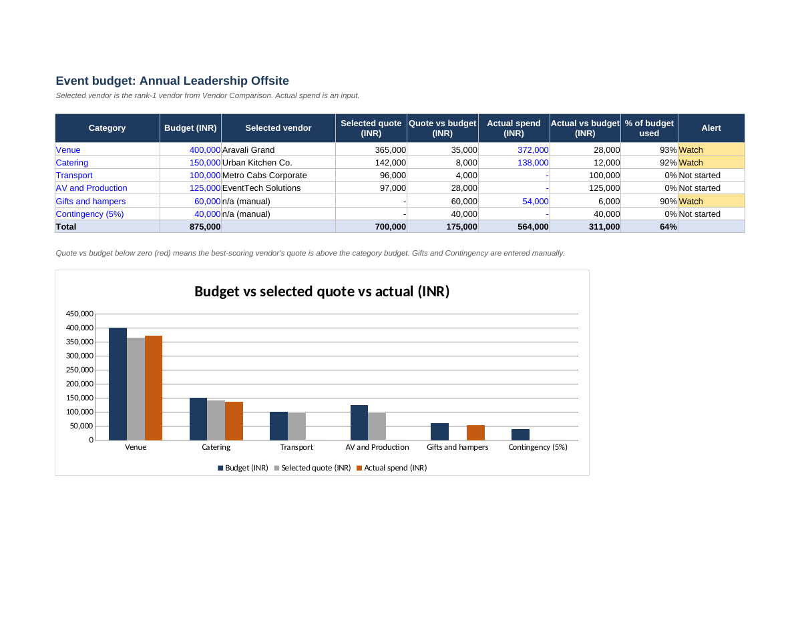
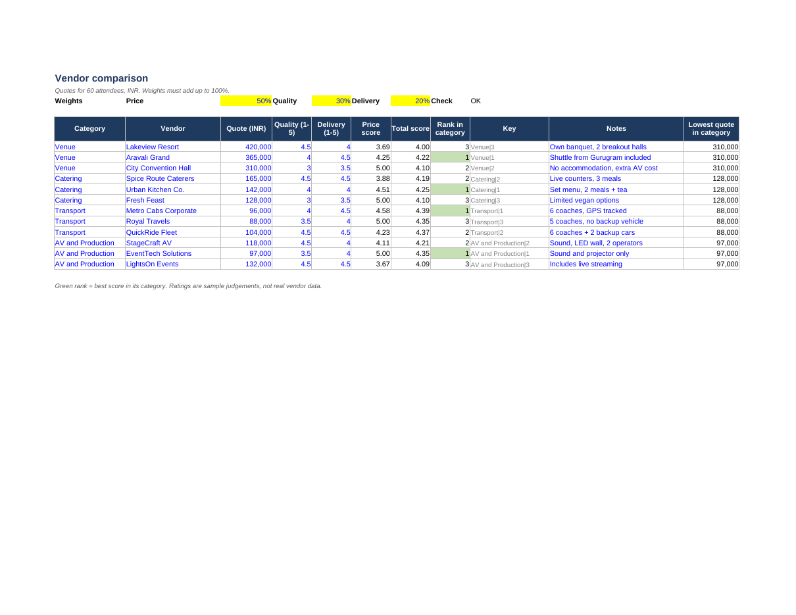

# Vendor and Event Budget Tracker

Compares vendor quotes with a weighted score, picks the best vendor per category, tracks budget vs quote vs actual spend, and routes each spend to the right approver. Sample event: an Annual Leadership Offsite for 60 attendees.

## The problem it solves
Vendor decisions for events and offsites are often made on price alone and tracked in scattered emails. This workbook makes the choice transparent and keeps spend visible against budget.

## What it does
- **Vendor Comparison:** 3 quotes per category (Venue, Catering, Transport, AV). Price score = 5 x lowest quote / this quote. Total score = weighted price, quality and delivery. Weights are editable and checked to total 100%. Rank 1 is highlighted.
- **Event Budget:** budget, best-ranked vendor and quote, actual spend, variance, % used and an alert (OK, Watch, Over budget).
- **Approvals:** spend log where the approver is calculated from limits (team lead, department head, VP), with pending value and days open.

## How to use
1. Enter quotes and 1-5 ratings (blue cells). 2. Adjust weights. 3. Enter actual spend. 4. Log approvals.

## Skills shown
Vendor management and negotiation prep, budget control, approval workflow design, Excel (MINIFS, COUNTIFS ranking, INDEX/MATCH, data validation, conditional formatting, charts).

## Notes
- Vendors, quotes, ratings and amounts are **fictional sample data**. Amounts in INR.
- Built by Anubhav Saxena with Claude as a build assistant. The approach mirrors how I handled vendor selection and expense control in executive-office roles.
